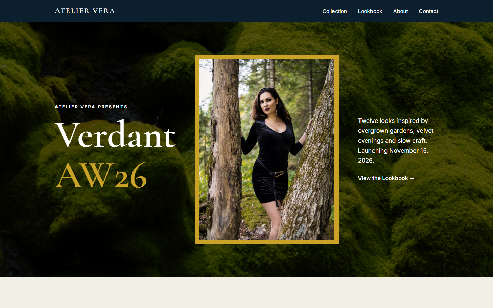
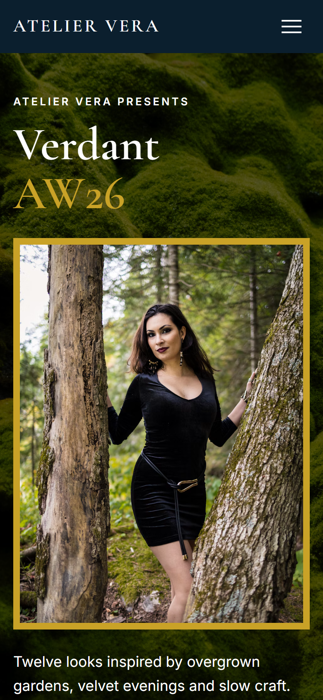
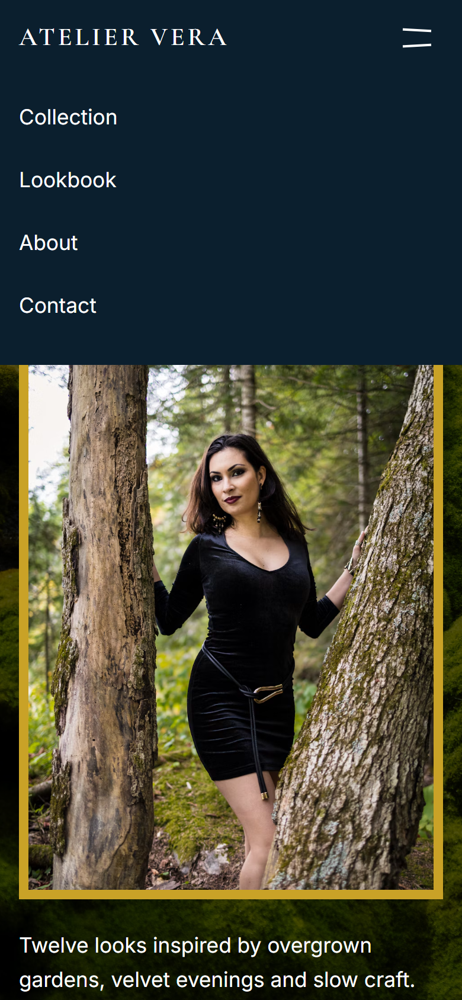
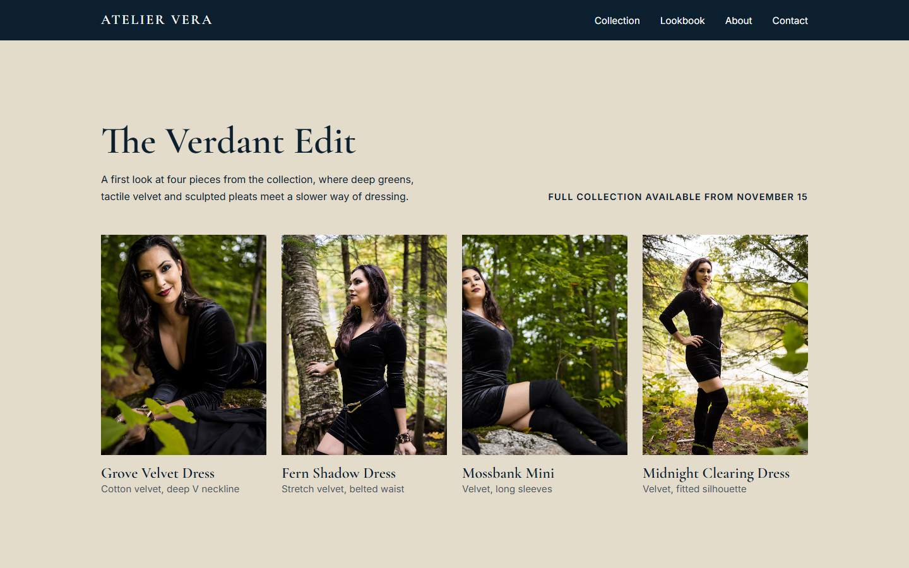

# Atelier Vera: Verdant AW26

A landing page that presents a new fashion collection, built twice: once in the **Wix** visual editor and once by hand in plain **HTML, CSS and JavaScript**.

Atelier Vera, Vera Lind and the Verdant AW26 collection are fictional. This is a demo project.

| Version | Link |
| --- | --- |
| Hand-coded (this repository) | https://demoncoder354.github.io/atelier-vera/ |
| Wix | https://zad177745.wixsite.com/my-site-2 |



## The brief

Present a new seasonal collection for a small fashion studio:

- a strong first screen with the collection name and launch date
- a launch details block ("Save the Date")
- a lookbook with a few key pieces
- a short brand and founder story
- a simple way to get in touch
- privacy policy and terms pages written in plain English

## Part 1: Wix

The first version was made in the Wix editor (Wix Harmony) from the "Fashion Designer" template, with the built-in AI assistant (Aria) used for bulk text rewrites.

Wix covered the content side well: rewriting copy, swapping photos, renaming portfolio projects. A few things needed manual fixes or could not be fixed at all:

- **Contrast.** The template header had white menu links on a transparent background, so they disappeared on light pages. Fixed by giving the header a solid navy background.
- **Mobile menu.** The hamburger panel opened with a cream background and white links, so it looked empty. Fixed in the hamburger editing mode.
- **Leftover template content.** Placeholder text in the legal pages, a fake customer testimonial and template brand logos had to be removed by hand.
- **Not fixed in Wix:** on mobile, the Portfolio widget is wider than the screen and cuts off the title, and the menu order (Home ends up last) could not be changed.

## Part 2: Hand-coded

The second version rebuilds the same page from scratch to fix the layout problems Wix left behind and to keep full control over the result.

<p>
  
  
</p>



### What it does

- Responsive layout with CSS Grid: 3 columns on desktop, 2 on tablet, 1 on phones, with no horizontal scroll at 375px
- Sticky header with an accessible mobile menu (`aria-expanded`, closes on Escape and after a link is chosen)
- Reveal-on-scroll animation with `IntersectionObserver`, switched off for `prefers-reduced-motion`
- Skip link, visible focus styles, alt text on every content image, semantic landmarks
- No cookies, no analytics, no forms: contact goes through a `mailto:` link
- Content Security Policy in a meta tag, allowing only this site, Bunny Fonts and Unsplash images
- Privacy and terms pages that describe what the site actually does

### Stack

- HTML5, CSS3 (custom properties, Grid, `clamp()` for fluid type)
- Vanilla JavaScript, about 50 lines, no build step and no dependencies
- Fonts: Cormorant Garamond and Inter via [Bunny Fonts](https://fonts.bunny.net) (a privacy-friendly Google Fonts mirror)
- Hosting: GitHub Pages

### Project structure

```
atelier-vera/
├── index.html        Landing page
├── privacy.html      Privacy policy (demo)
├── terms.html        Terms and conditions (demo)
├── css/style.css     All styles
├── js/main.js        Mobile menu and scroll reveal
├── assets/           Favicon
└── docs/             Screenshots for this README
```

### Run locally

Any static server works, for example:

```bash
python -m http.server 8000
```

Then open http://localhost:8000.

## Photo credits

All photos are from [Unsplash](https://unsplash.com) and used under the [Unsplash License](https://unsplash.com/license). They are loaded from the Unsplash CDN, not stored in this repository.

| Where | Photographer | Photo |
| --- | --- | --- |
| Hero, lookbook, about | [@kingdog123](https://unsplash.com/@kingdog123) | [1](https://unsplash.com/photos/0o-7rSpEr6w), [2](https://unsplash.com/photos/E92FQtAA9U4), [3](https://unsplash.com/photos/hsWTfMrFakk), [4](https://unsplash.com/photos/q_C8Il0IBi4), [5](https://unsplash.com/photos/o5s_k092990), [6](https://unsplash.com/photos/Or0Br1LRSws) |
| Hero background (moss) | [@munkstt](https://unsplash.com/@munkstt) | [link](https://unsplash.com/photos/qiWaWWhehTo) |
| Studio (thread spools) | [@liliantruong2603](https://unsplash.com/@liliantruong2603) | [link](https://unsplash.com/photos/TUdt7FdMeiU) |

The Wix version uses images from the Wix media library.

## License

Code: [MIT](LICENSE). Photos: Unsplash License, owned by their photographers.
